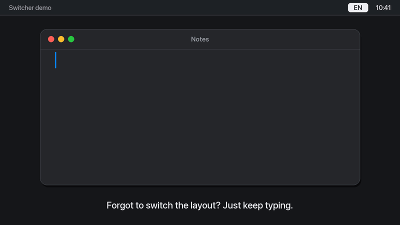

# Switcher

An invisible automatic keyboard layout switcher for macOS, similar to Punto Switcher.
It has no Dock icon, no menu bar icon and no windows.



## Features

- **Auto-correction**: type `ghbdsn` and press space, and you get `привіт ` with the layout switched to Ukrainian.
  The same goes the other way: `руддщ` becomes `hello`.
- **Double Shift**: converts the last word to the other layout. If the word was just auto-corrected,
  double Shift undoes the correction and remembers the word as an exception, so it is never corrected again.
- Auto-correction is off in terminals and code editors (Terminal, iTerm, Warp, Ghostty, Xcode, VS Code, Cursor, JetBrains).
  Double Shift still works there.
- In password fields macOS itself hides keystrokes from the app.

## How it decides

A word is corrected only when the typed text is **not** a word and the same keys in the other layout **are** a word.
The check uses the spell checker built into macOS (English, Ukrainian, Russian and more).
One-letter words are never corrected.

## Why it doesn't lag

- Each keystroke is only appended to an array. Character tables for the layouts are built once at startup.
- The dictionary is checked only on space and takes less than 1 ms.
- No timers, no polling, no network. When idle, the app uses no CPU.

## Installation

```bash
./install.sh
```

The script builds the app, copies it to `~/Applications/Switcher.app`, launches it and adds it to login items.
Then allow it in **System Settings → Privacy & Security**:
**Accessibility** and **Input Monitoring**.
The app starts working within 2 seconds after permission is granted, no restart needed.

After every reinstall the permission has to be granted again: the build is signed locally (ad-hoc),
so macOS treats each new build as a different app.

## Usage

Stop:

```bash
pkill -x Switcher
```

Start:

```bash
open ~/Applications/Switcher.app
```

Uninstall:

```bash
./uninstall.sh
```

Add your own apps where auto-correction is off (bundle IDs):

```bash
defaults write com.pivden.switcher ExcludedApps -array com.tinyspeck.slackmacgap
```

Clear the list of word exceptions:

```bash
defaults delete com.pivden.switcher Exceptions
```

Check detection without installing:

```bash
swift run -c release Switcher --test
```

## Structure

- `Sources/Switcher/Engine.swift`: keyboard interception (CGEventTap), word buffer, text replacement.
- `Sources/Switcher/Layouts.swift`: layouts, key → character tables, switching.
- `Sources/Switcher/Detector.swift`: decides whether to correct a word.
- `Sources/Switcher/main.swift`: startup, permissions, login item.
- `scripts/make_demo_gif.py`: renders `docs/demo.gif` (needs Pillow).

## License

MIT, see [LICENSE](LICENSE).
